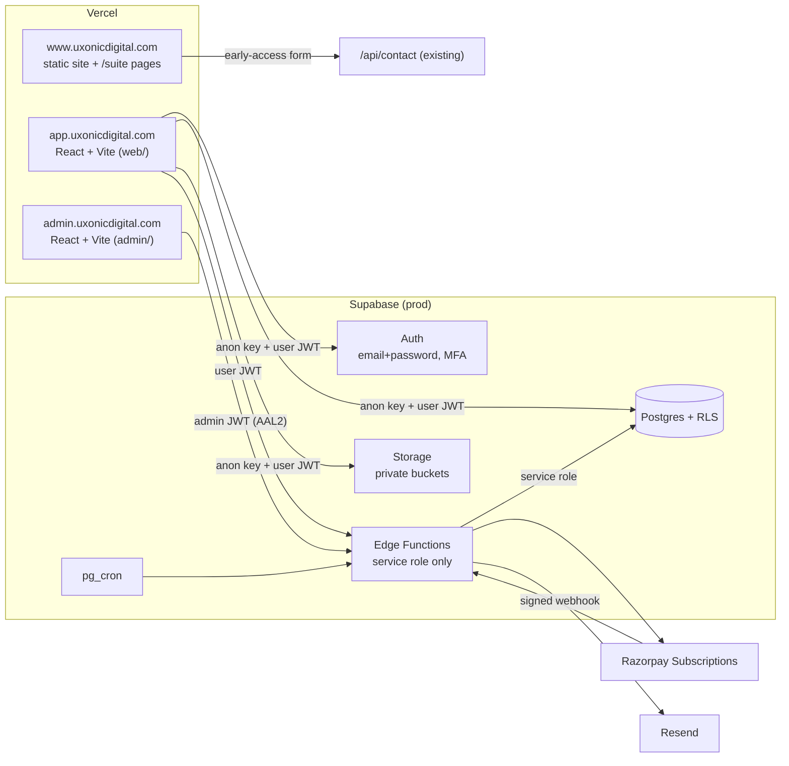
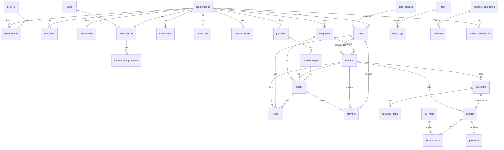
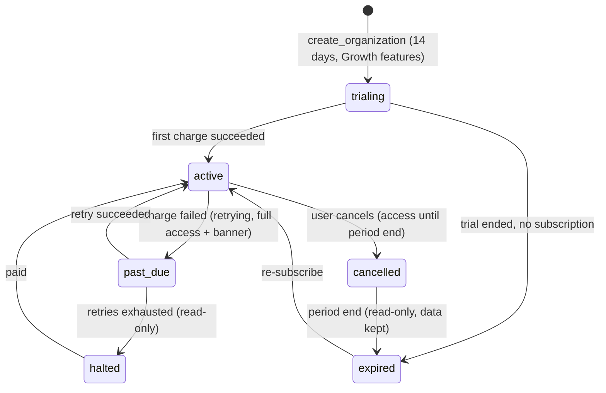

# UXONIC Business Suite — Architecture & Build Plan

Status: **for approval** — no platform code is written until this is signed off (master prompt §17).
Done so far: marketing landing pages on www (`/suite`, `/suite/crm`, `/suite/billing`, `/suite/erp`, `/suite/hr`).

---

## 0. Decisions I need from you

| # | Question | My recommendation |
|---|---|---|
| D1 | Where does the app code live? | **New repo `uxonic-business-suite`** (monorepo). This repo is deployed with `outputDirectory: "."`, so anything placed here — including a React app's source — is publicly served. Keep www (marketing + the internal UXONIC ERP) here. |
| D2 | Supabase projects | **Two new projects**: `suite-staging`, `suite-prod`. Do not reuse the website/internal-ERP project. |
| D3 | Email provider | **Resend** (already integrated). Verify `uxonicdigital.com` with SPF, DKIM and DMARC before launch. |
| D4 | Razorpay | Needs a business account with KYC complete and Subscriptions enabled; test keys for staging. |
| D5 | Brand colours | Landing pages use the current site tokens (ink `#111114`, violet `#6B4EFF`, lavender `#C9B6FF`, lime `#E4FF1A`). The app will use the same tokens unless you send others — they live in one token file. |
| D6 | Name clash | The internal tool at `/erp` (UXONIC's own payroll/attendance) is not the product "UXONIC ERP". Suggest renaming the internal one to "UXONIC Office" in its UI to avoid confusion. Optional. |
| D7 | Email domain | Master prompt uses `info@uxonicdigital.com`; the website currently uses `uxonicdigitalmedia@gmail.com`. Confirm `info@` exists. |

---

## 1. System architecture



- Browser only ever holds the **anon key** + the user's JWT. All tenant isolation is RLS.
- **Edge Functions** handle anything with secrets: Razorpay, webhooks, invitations, PDF generation, emails, scheduled jobs, super-admin actions.
- **pg_cron** calls functions daily/hourly (trial expiry, overdue invoices, task reminders).
- DNS on Cloudflare: `www`, `app`, `admin` (later `help`, `status`).

## 2. Module registry

**Database (source of truth for gating):**

```sql
modules(key text pk, name, description, status)   -- crm, billing, erp, hr; status: live | coming_soon
plans(code pk, name, price_monthly_paise, price_yearly_paise, max_users, max_contacts,
      max_invoices_per_month, modules text[], features jsonb, rzp_plan_monthly,
      rzp_plan_yearly, is_active, sort_order)
org_has_module(p_org, p_module) → bool   -- module live AND in org's effective plan AND org not suspended
org_has_feature(p_org, p_feature) → bool -- plans.features ? p_feature (trial = Growth features)
```

**Frontend (`web/src/app/moduleRegistry.ts`):**

```ts
type ModuleDef = {
  key: 'crm' | 'billing' | 'erp' | 'hr';
  nameKey: string;                 // i18n key
  icon: IconName;
  routes: RouteObject[];           // lazy-loaded
  nav: { labelKey: string; path: string; perm: PermissionKey }[];
  dashboardWidgets?: WidgetDef[];
};
```

Sidebar shows a module when `modules.status = 'live'` **and** `org_has_module`. `coming_soon` modules render a "Coming soon" page.

**Adding ERP/HR later:** add `web/src/modules/erp/`, `supabase/migrations/erp_*.sql` (tables + RLS using the same helpers), Edge Functions if needed, register in `moduleRegistry.ts`, flip `modules.status` to `live`, add `'erp'` to plan `modules[]`. No change to auth, tenancy, billing, navigation or permissions.

## 3. Database schema (core, CRM, Billing)

Conventions: `uuid` PKs, `created_at/updated_at` (trigger), `deleted_at` where restore matters, `numeric(14,2)` for customer money, integer paise for SaaS billing, every tenant table has `org_id` first in its indexes, composite FKs `(org_id, id)` keep references inside one org.



**Core:** `profiles(id=auth.uid, full_name, phone, locale)`, `organizations(id, name, slug, gstin, state_code, address jsonb, logo_path, timezone default 'Asia/Kolkata', currency default 'INR', status active|suspended, deletion_requested_at)`, `memberships(org_id, user_id, role admin|manager|employee, status active|deactivated)`, `invitations(org_id, email, role, token_hash, expires_at, accepted_at, invited_by)`, `role_permissions(org_id null=default, role, permission)`, `org_settings(org_id, invoice_prefix, quote_prefix, default_terms_days, default_tax_rate_id, upi_id, bank jsonb, notes)`, `notifications`, `audit_logs(org_id, actor_id, action, entity, entity_id, before jsonb, after jsonb, at)`, `support_tickets`, `modules`, `plans`, `subscriptions(org_id unique, plan_code, cycle, status, trial_ends_at, current_period_end, cancel_at_period_end, pending_plan_code, rzp_subscription_id)`, `subscription_payments`, `webhook_events(id = razorpay event id pk, payload, processed_at)`, `platform_admins`, `platform_settings`.

**CRM:** `companies`, `contacts(company_id, owner_id, …)`, `leads(name, phone, email, company_name, source_id, status, priority, owner_id, follow_up_at, notes, converted_contact_id, deleted_at)`, `lead_sources`, `tags` + `entity_tags(org_id, tag_id, entity, entity_id)`, `pipelines`, `pipeline_stages(position, kind open|won|lost, probability)`, `deals(title, value, contact_id, company_id, stage_id, owner_id, expected_close, probability, lost_reason)`, `tasks(title, assignee_id, due_at, remind_at, priority, status, lead_id|contact_id|deal_id)`, `activities(entity, entity_id, kind note|call|status|email|task, body, actor_id)`.

**Billing:** `tax_rates(name, rate)`, `number_sequences(org_id, kind, fy, next_value)` — incremented with `UPDATE … RETURNING` inside the issuing RPC (row lock → no gaps, no duplicates), `quotations` + `quotation_items`, `invoices(number, status, contact_id, place_of_supply, issue_date, due_date, subtotal, cgst, sgst, igst, total, amount_paid, voided_at, void_reason)` + `invoice_items(description, hsn_sac, qty, unit, rate, discount, tax_rate, product_id null — for ERP later)`, `payments(invoice_id, amount, paid_on, method, reference)`, `expense_categories`, `expenses(…, submitted_by, approved_by, receipt_path)`.

Line items store their own description/rate/tax snapshot, so issued invoices never change. `branch_id uuid null` is reserved as an additive column for ERP/HR.

Search: `pg_trgm` GIN indexes on names, phones and emails.

## 4. RLS policy matrix

Helpers (all `SECURITY DEFINER`, `set search_path = public`): `is_org_member`, `org_role`, `has_permission`, `is_platform_admin`, `org_has_module`, `org_has_feature`, `org_is_writable`.

Legend: **M** = member of org · **W** = `org_is_writable` · **mod** = `org_has_module` · **own** = `owner_id = auth.uid()` or assigned · **A/Mg/E** = admin/manager/employee · ✗ = no client policy (service role only)

| Table | SELECT | INSERT | UPDATE | DELETE |
|---|---|---|---|---|
| organizations | M | ✗ (RPC `create_organization`) | A + W | ✗ (deletion request RPC) |
| memberships | M | ✗ (RPC accept invite) | A (role/status) | ✗ |
| invitations | A | A + W + seat limit | A | A |
| org_settings | M | ✗ (created by RPC) | A + W | ✗ |
| role_permissions | M | ✗ | ✗ (later: A on Business) | ✗ |
| subscriptions, subscription_payments | A | ✗ | ✗ | ✗ |
| plans, modules | anyone authenticated (active rows) | ✗ | ✗ | ✗ |
| webhook_events, platform_admins, platform_settings | ✗ | ✗ | ✗ | ✗ |
| audit_logs | A | ✗ (triggers) | ✗ | ✗ |
| notifications | own user | ✗ (functions) | own user (read flag) | own user |
| support_tickets | A, creator | M + W | creator (until closed) | ✗ |
| companies, contacts | M + mod(crm) | M + mod + W + contact limit | A/Mg any; E own + W | A/Mg + W (soft) |
| leads, deals, tasks | A/Mg all; E own/assigned | M + mod + W (+ contact limit for leads) | A/Mg any; E own + W; reassign only A/Mg | A/Mg + W (soft) |
| activities | same visibility as parent entity | M + W | author within 15 min | A/Mg |
| lead_sources, tags, pipelines, pipeline_stages | M + mod | A/Mg + W (multi-pipeline feature gate) | A/Mg + W | A/Mg + W |
| quotations, invoices (+items) | A/Mg all; E own | M + mod(billing) + W + invoice-per-month limit | A/Mg; E own drafts only; issued invoices only via RPC | ✗ (void via RPC) |
| payments | A/Mg; E for own invoices | A/Mg + W | A/Mg + W | A/Mg + W |
| expenses | A/Mg all; E own | M + mod + W | A/Mg; E own while pending | A/Mg |
| tax_rates, expense_categories | M + mod | A + W | A + W | A + W |
| number_sequences | ✗ | ✗ | ✗ (RPC only) | ✗ |

Storage: buckets `org-logos`, `attachments`, `documents` — private; object path `<org_id>/…`; policies check `is_org_member((storage.foldername(name))[1]::uuid)`; downloads via signed URLs.

## 5. RPCs and Edge Functions

**RPCs (Postgres, called with the user's JWT):**

| Function | Input | Output | Caller |
|---|---|---|---|
| `create_organization` | name, phone, address, gstin, state_code, timezone | org_id | any signed-in user |
| `accept_invitation` | token | org_id | invited user |
| `convert_lead` | lead_id, create_company bool, deal jsonb? | contact_id, deal_id | M with create perm |
| `move_deal` | deal_id, stage_id, lost_reason? | deal | owner or A/Mg |
| `issue_quotation` / `issue_invoice` | draft id | number | A/Mg (E own) |
| `convert_quote_to_invoice` | quotation_id | invoice_id | A/Mg |
| `void_invoice` | invoice_id, reason | invoice | A/Mg |
| `record_payment` | invoice_id, amount, date, method, ref | payment, invoice status | A/Mg |
| `org_usage` | — | users/contacts/invoices vs limits | M |
| `request_org_deletion` / `cancel_org_deletion` | — | — | A |

**Edge Functions (service role inside, verify JWT first):**

| Function | Purpose | Caller |
|---|---|---|
| `invite-member` | create invitation + send email | A |
| `billing-create-subscription` | create Razorpay subscription for plan + cycle | A |
| `billing-change-plan` / `billing-cancel` | upgrade now / downgrade at period end (with limit check) / cancel | A |
| `razorpay-webhook` | verify signature → `webhook_events` (idempotent) → update subscription + payments | Razorpay |
| `document-pdf` | render quote/invoice PDF to Storage, return signed URL | M |
| `send-document` | email quote/invoice with PDF link | A/Mg |
| `cron-daily` | trial expiry, overdue detection, reminder emails, deletion after 30 days | pg_cron |
| `cron-hourly` | task and follow-up reminders | pg_cron |
| `org-export` | CSV/JSON zip of the org | A (plan-gated) |
| `admin-*` | metrics, orgs, plans, payments, tickets, settings | platform admin with AAL2 |

## 6. Permission keys and default mapping

`crm.leads.read_all`, `crm.leads.update_any`, `crm.leads.delete`, `crm.assign`, `crm.pipeline.manage`, `crm.import`, `billing.quotes.manage`, `billing.invoices.issue`, `billing.invoices.void`, `billing.payments.record`, `billing.expenses.approve`, `billing.settings.manage`, `reports.view_team`, `data.export`, `team.manage`, `org.settings.manage`, `org.billing.manage`, `audit.view`.

| Key | Admin | Manager | Employee |
|---|:-:|:-:|:-:|
| crm.leads.read_all / update_any / delete, crm.assign, crm.pipeline.manage | ✔ | ✔ | – |
| crm.import | ✔ | ✔ | – |
| billing.quotes.manage, billing.invoices.issue | ✔ | ✔ | own |
| billing.invoices.void, billing.payments.record, billing.expenses.approve | ✔ | ✔ | – |
| reports.view_team | ✔ | ✔ | – |
| data.export | ✔ | ✔ (if plan) | – |
| team.manage, org.settings.manage, org.billing.manage, billing.settings.manage, audit.view | ✔ | – | – |

## 7. Frontend routes and components

`/login` `/signup` `/verify` `/forgot` `/reset` `/invite/:token` · `/onboarding/(workspace|company|team)` · `/:org/overview` · CRM: `/:org/crm/leads`, `/leads/:id`, `/contacts`, `/contacts/:id`, `/companies`, `/companies/:id`, `/pipeline`, `/tasks`, `/reports` · Billing: `/:org/billing/quotations(/new|/:id)`, `/invoices(/new|/:id)`, `/payments`, `/expenses`, `/reports`, `/customers/:id/statement` · `/:org/erp/*`, `/:org/hr/*` → Coming soon · `/:org/team` · `/:org/settings/(organization|billing-defaults|subscription|profile|security)`.

Admin app: `/login` (+TOTP) · `/metrics` · `/orgs`, `/orgs/:id` · `/plans` · `/payments` · `/tickets` · `/settings` · `/audit`.

Components: Button, Input, Select, Combobox, DatePicker, Textarea, Checkbox, Switch, Table, Pagination, Tabs, Dialog, ConfirmDialog, Drawer, DropdownMenu, Toast, StatusPill, Avatar, KpiCard, ChartCard, EmptyState, ErrorState, Skeleton, FileUpload, PageHeader, FilterBar, plus PermissionGate, ModuleGate, ReadOnlyBanner, TrialBanner.

## 8. Subscription state machine



Flow: Admin picks plan + cycle → `billing-create-subscription` → Razorpay Checkout in browser → **nothing unlocks from the browser callback** → `razorpay-webhook` (signature checked, event id stored once) updates `subscriptions` and inserts `subscription_payments`. Event names (`subscription.activated`, `.charged`, `.pending`, `.halted`, `.cancelled`, `.completed`, `payment.failed`, …) and payload fields will be confirmed against current Razorpay docs before Phase 4.

`org_is_writable` = org not suspended AND status in (`trialing` within trial, `active`, `past_due`, `cancelled` before period end).

## 9. Build order

| Phase | Scope | Done means |
|---|---|---|
| 0 ✔ | Marketing pages on www | `/suite` + 4 module pages live, early-access form stores leads |
| 1 Core | repo, CI, tokens + UI kit, i18n, auth, onboarding RPC, workspace switcher, app shell, team & invites, settings, notifications, audit triggers | Two orgs created from UI; RLS test suite proves no cross-org access on every core table; typecheck + lint + smoke tests green |
| 2 CRM | leads (import/export), contacts, companies, pipeline, tasks, activities, reminders cron, CRM reports, overview widgets | Full lead → deal → won flow by three roles; employee visibility tests; seed data |
| 3 Billing | tax rates, numbering, quotations, invoices, payments, PDF + UPI QR, email, overdue job, expenses, billing reports | Totals/tax unit tests; numbering concurrency test; quote → invoice → paid flow |
| 4 Subscriptions | plans/limits, Razorpay checkout, webhook, state machine, read-only mode, usage limits, billing history | Webhook payload tests for every transition; test-mode end-to-end payment |
| 5 Super admin | separate app, MFA, metrics, org management, plans editor, tickets, audit | Non-admin and non-MFA access rejected; every action audited |
| 6 Hardening | export & deletion, rate limits, monitoring, backups + restore drill, DPDP docs, dependency audit, load test | Deployment checklist (§16 of master prompt) fully ticked |

After each phase you get: what works, what does not, how to run/test it, decisions needed.

## 10. Risks, assumptions, open questions

- **Scope/time:** this is a multi-month product. Phases 1–3 are the minimum to charge customers; I will not cut RLS or auth corners to go faster.
- **GST wording:** UI says "tax invoice" and shows CGST/SGST/IGST; we never say "GST compliant" until a CA reviews sample invoices. E-invoicing/e-way bills out of scope.
- **Razorpay Subscriptions** requires account approval; UPI Autopay mandates have amount caps — confirm limits for yearly plans.
- **Email deliverability:** without SPF/DKIM/DMARC on `uxonicdigital.com`, invites and invoices will land in spam.
- **PDF generation** in Edge Functions (Deno) — plan: HTML template → PDF via a Deno-compatible library; fallback is a dedicated render function if fonts/₹ glyph cause issues.
- **Tamil later:** all strings via i18next from day one; number/date formatting via `Intl` with `en-IN`.
- **Assumption:** one currency (INR) and one tax regime (India) at launch.
- **Legal:** privacy policy, terms and data-deletion process need a legal review (DPDP Act 2023).
